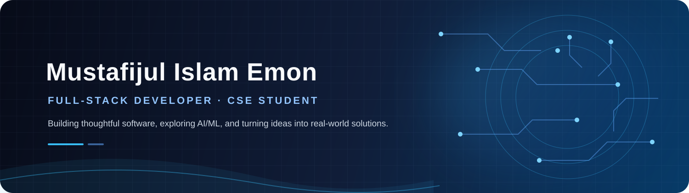
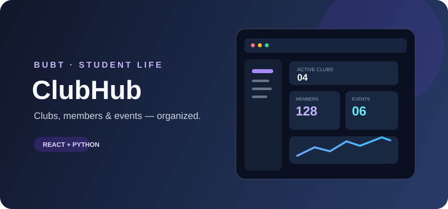
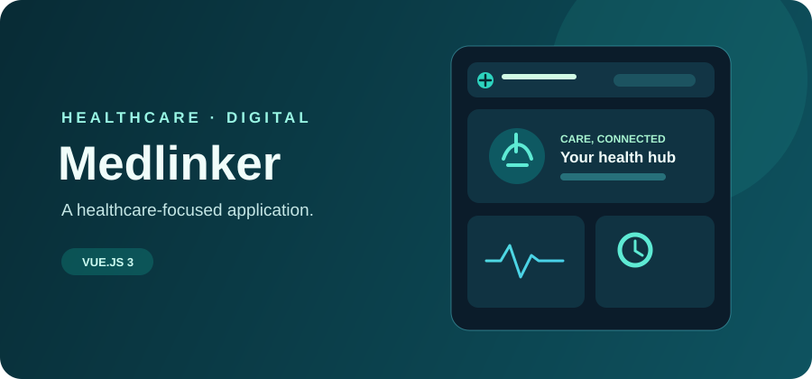
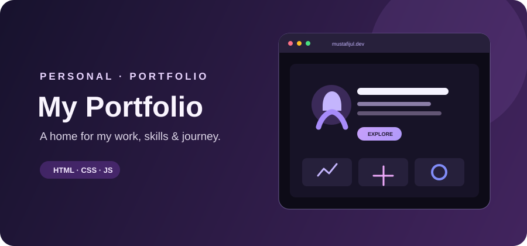
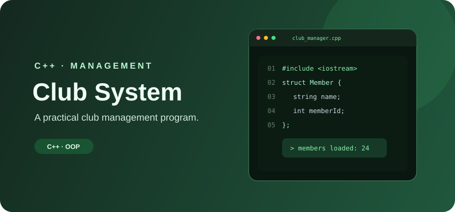

  

 

**BUILDING • LEARNING • INNOVATING**

---

## 👨‍💻 About Me

Hello! I'm **Mustafijul Islam Emon**, a Computer Science and Engineering student at **Bangladesh University of Business and Technology (BUBT)**.

I'm a passionate programmer and aspiring Full-Stack Developer who enjoys building practical software solutions, solving real-world problems, and exploring emerging technologies.

My development journey focuses on creating meaningful applications that combine functionality, usability, and thoughtful engineering.

- 🎓 B.Sc. in Computer Science & Engineering at BUBT
- 💻 Aspiring Full-Stack Developer
- 🚀 Interested in Software Engineering and Application Development
- 🧠 Exploring Artificial Intelligence and Machine Learning
- 📊 Data Science and Explainable AI Enthusiast
- 🤝 Experienced in collaborative software development projects
- 🌱 Continuously learning, experimenting, and improving

---

## 🚀 Featured Projects

A selection of academic and personal projects, presented with original visual previews.

<table>
<tr>
<td width="50%" valign="top">

### 🏛️ ClubHub

A club management app for organizing clubs, members, and event requests.

`React` `Python Flask` `SQLite`

<a href="https://github.com/mustafijulemon/BUBT-CLUBHUB-SDP2">↗ View source</a>

</td>
<td width="50%" valign="top">

### 🩺 Medlinker

A healthcare-focused application project.

`Vue.js 3` `Vue Router` `Vite`

<a href="https://github.com/mustafijulemon/Medlinker">↗ View source</a>

</td>
</tr>
<tr>
<td width="50%" valign="top">

### 💼 Personal Portfolio

A personal website showcasing my projects, skills, and developer journey.

`HTML` `CSS` `JavaScript`

<a href="https://github.com/mustafijulemon/My_portfolio-main">↗ View source</a>

</td>
<td width="50%" valign="top">

### 👥 Club Management System

A command-line club management project built as a programming exercise.

`C++` `Object-Oriented Programming`

<a href="https://github.com/mustafijulemon/Club-Management-System-In-C">↗ View source</a>

</td>
</tr>
</table>

---

## 🧪 Research & Innovation

### ❤️ Explainable ML Framework for Early Heart Disease Prediction and Risk Assessment

An academic research project exploring explainable machine learning techniques for early heart disease prediction and risk assessment.

**Key Components:**

- Data preprocessing and exploratory analysis
- Logistic Regression, Decision Tree, SVM and KNN
- Random Forest-based prediction
- SHAP-based global explainability
- LIME-based local explainability
- Model evaluation and comparison

**Technologies:**

`Python` `Scikit-learn` `Random Forest` `SHAP` `LIME`

---

## 🛠️ Technical Skills & Technologies

### Programming Languages

### Frontend Development

### Backend & Database

### Tools & Development Environment

### Data Science & Machine Learning

`Python` · `Scikit-learn` · `Random Forest` · `SHAP` · `LIME`

---

## 📊 GitHub Analytics

  

---

## 📈 Contribution Graph

---

## 🏆 Achievements & Recognition

### 🎓 Academic

- **B.Sc. in Computer Science & Engineering, BUBT** — CGPA 3.93.
- Earned **4.00 SGPA** in multiple semesters.
- **HSC (Science)** — GPA 5.00.
- Research: Explainable Machine Learning for Heart Disease Prediction and Risk Assessment.

### 💻 Competitive Programming

- **5th Place** — BUBT Preliminary Programming Contest 2025, Senior Division.
- **11th Place** — ICPC Asia Dhaka Regional Preliminary Contest, BUBT team.
- **19th Place** — BUBT Onsite Contest 2024.
- Competed in ICPC and BUET programming contests.

### 🎙️ Debate & National Television

- **National Champion** — Debate for Democracy on ATN Bangla.
- **15+ appearances** in televised debate programs.
- **National TV Debate Champion Team (2022)**.
- **Runner-up** — ATN National TV Debate (2023).
- Finalist in multiple nationally televised debate competitions.

### 👑 Leadership & Organizing

- **President, Debating Club of BUBT** — 2nd Executive Committee (2026–27).
- Convenor of the 1st National Debate Competition 2026, featuring 32 universities.
- Tournament Director, 5th Inter Department Debate Competition 2026.
- ICPC contest organizing volunteer (2025).

---

## 💡 Beyond Coding

I believe software engineering is not only about writing code.
Leadership, critical thinking, communication, teamwork, and problem-solving are equally important.

My experience in competitive debating and organizing national-level events has helped me develop these skills alongside my technical journey.

---

## 🤝 Let's Connect

I'm always open to connecting with developers, exchanging ideas, collaborating on meaningful projects, and exploring new opportunities.

  

### 💙 BUILD. LEARN. INNOVATE. REPEAT.

*Turning ideas into solutions, one project at a time.*

